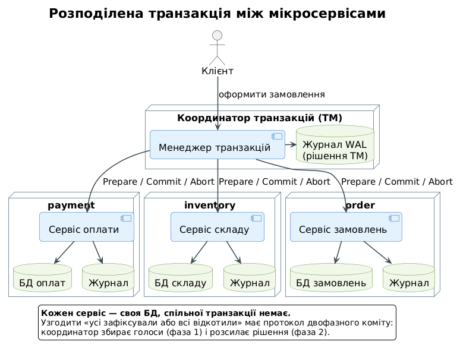
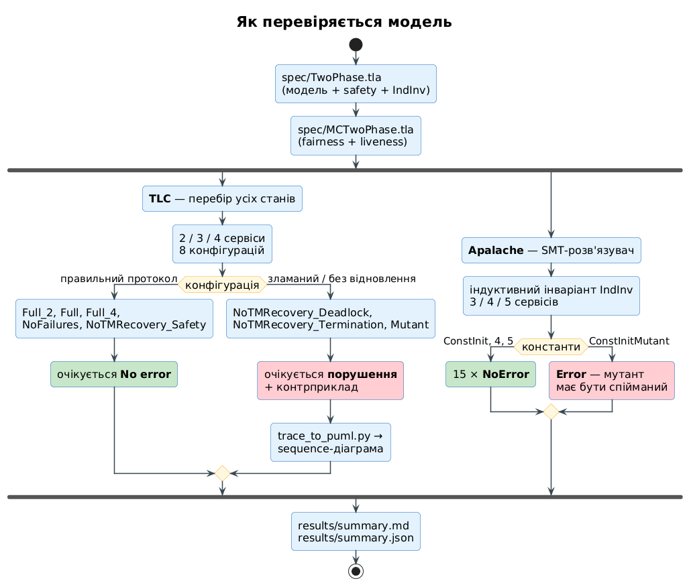

# Формальна верифікація протоколу двофазного коміту (2PC)

[](https://github.com/playerunknow/2pc-formal-verification/actions/workflows/verify.yml)

> **Тема 2.3.** Формальна перевірка протоколу двофазного коміту (Two-Phase Commit):
> моделювання розподілених транзакцій між мікросервісами. Доведення того, що система не
> залишається в частково зафіксованому стані (Deadlock).

**Автор:** Динник Михайло Андрійович, група 171М

**Дисципліна:** «Формальні методи інженерії програмного забезпечення», спеціальність 121
«Інженерія програмного забезпечення», Херсонський державний університет

## Коротко

- **Що верифікуємо:** протокол 2PC для транзакції між мікросервісами (payment, inventory,
  order) з координатором, в асинхронній мережі, що губить, дублює і переставляє
  повідомлення, і з падіннями та відновленням будь-якого вузла.
- **Чим:** TLA+ і три інструменти — **TLC** (перебір усіх станів), **Apalache**
  (індуктивний інваріант через SMT), **TLAPS** (доведення для будь-якої кількості сервісів).
- **Головний результат:** частково зафіксованого стану немає в жодному досяжному стані
  (TLC для 2–4 сервісів, Apalache для 3–5, TLAPS — для будь-якого N), а Deadlock відсутній,
  якщо координатор відновлюється з журналу. Без відновлення 2PC блокується — TLC показує
  трасу. Навмисно зламаний координатор ловиться за 0,6 с.
- **25 з 25** перевірок дали очікуваний вердикт.





## Чому без реалізації

Верифікується **модель протоколу**, а не код сервісів. Помилки 2PC — у логіці протоколу:
хто, коли і на підставі чого приймає рішення, що робити після падіння і втрати
повідомлення. У HTTP-обробниках чи SQL-запитах їх немає. Модель відкидає все, що на
протокол не впливає, і тому її можна перевірити **повністю**, а не на кількох сценаріях,
як тестами. Так працюють і в індустрії: Amazon (DynamoDB, S3), MongoDB, CockroachDB
спершу описують і перевіряють протоколи в TLA+, а вже потім пишуть код.

## Властивості

| | Властивість | Людською мовою |
|---|---|---|
| S1 | `TypeOK` | змінні мають коректні «типи» |
| S2 | `Consistency` | **немає частково зафіксованого стану**: ніхто не закомітив, поки інший відкотив |
| S3 | `CommitValidity` | commit лише якщо всі проголосували «так» |
| S4 | `DecisionStable`, `RMStable` | рішення не змінюються |
| S5 | `FollowsTM` | учасники виконують рішення координатора |
| L1 | `DeadlockFree` | **немає Deadlock**: поки транзакція не завершена, можливий крок протоколу |
| L2 | `Termination` | якщо збої колись припиняються, транзакція завершується |
| L3 | `EventualCommit` | хтось закомітив → закомітять усі |
| L4 | `NonTriviality` | усі «так» і без збоїв → commit |

Детально — [docs/properties.md](docs/properties.md).

## Результати

**TLC** (повна таблиця — [results/summary.md](results/summary.md)):

| Конфігурація | Сервісів | Distinct states | Глибина | Час | Вердикт |
|---|---|---|---|---|---|
| Full_2 | 2 | 1 840 | 15 | 1,1 с | ✔ No error |
| Full | 3 | 28 832 | 20 | 3,7 с | ✔ No error |
| Full_4 | 4 | 477 760 | 25 | 51 с | ✔ No error |
| NoFailures | 3 | 163 | 11 | 0,8 с | ✔ No error (вкл. L4) |
| NoTMRecovery_Safety | 3 | 28 828 | 21 | 1,4 с | ✔ No error |
| NoTMRecovery_Deadlock | 3 | — | — | 0,6 с | ✘ `DeadlockFreeNoTMRecovery` (очікувано) |
| NoTMRecovery_Termination | 3 | — | — | 3,6 с | ✘ `Termination` (очікувано) |
| Mutant | 3 | — | — | 0,6 с | ✘ `Consistency` (очікувано) |

**Apalache:** 15 з 15 перевірок індуктивного інваріанта для 3, 4, 5 сервісів — `NoError`;
мутант — `Error` (очікувано).

**TLAPS:** теорему `Spec => [](Consistency /\ CommitValidity /\ FollowsTM)` для
довільної кількості сервісів доведено, 61 з 61 зобов'язань.

Порушення в останніх трьох рядках **заплановані**: вони показують, що без відновлення
координатора 2PC блокується (результат Скіна, 1981) і що властивості ловлять зламаний
протокол. Розбір — у [docs/results.md](docs/results.md).

## Швидкий старт

Потрібні **Python 3.10+** і **Java 17+** (лише як рантайм; Ubuntu:
`sudo apt install openjdk-21-jre-headless`).

```bash
python scripts/setup_tools.py          # завантажити TLC, Apalache, PlantUML у tools/
python scripts/run_all.py              # усі перевірки -> results/ (~2 хв)
python scripts/run_one.py Mutant       # одна конфігурація з поясненням контрприкладу
```

Додатково: `python scripts/setup_tools.py --tlaps` — встановити TLAPS (Linux x86_64),
тоді `run_all.py` перевірить і доведення. `python scripts/render_diagrams.py` —
перерендерити діаграми. Те саме через `make setup`, `make verify`, `make demo`,
`make diagrams`.

## Структура репозиторію

```
spec/
  TwoPhase.tla            модель, safety-властивості, індуктивний інваріант
  MCTwoPhase.tla          fairness, liveness-властивості
  TwoPhaseProofs.tla      доведення TLAPS для довільного N
  configs/*.cfg           8 конфігурацій TLC
scripts/
  setup_tools.py          завантаження інструментів
  run_all.py              усі перевірки -> results/
  run_one.py              одна перевірка для демо, контрприклад по кроках
  trace_to_puml.py        контрприклад TLC -> PlantUML sequence-діаграма
  render_diagrams.py      .puml -> PNG/SVG
  common.py               спільні функції, очікувані вердикти
results/
  summary.md / .json      зведені результати
  tlc/ apalache/ tlaps/   сирі логи
diagrams/
  *.puml                  12 діаграм для презентації
  generated/*.puml        згенеровані з контрприкладів TLC
  rendered/               PNG і SVG
docs/                     документація (див. нижче)
tools/                    інструменти (не в git, завантажуються скриптом)
.github/workflows/        CI: прогін перевірок на кожен push
```

## Документація

| Файл | Що всередині |
|---|---|
| [docs/overview.md](docs/overview.md) | одна сторінка: проблема, модель, результат, висновок |
| [docs/model.md](docs/model.md) | як влаштована модель: стани, мережа, збої, усі дії |
| [docs/properties.md](docs/properties.md) | S1–S5, L1–L4: формули і пояснення |
| [docs/tla_for_python_devs.md](docs/tla_for_python_devs.md) | TLA+ для Python-розробника |
| [docs/results.md](docs/results.md) | результати і розбір контрприкладів |
| [docs/demo_guide.md](docs/demo_guide.md) | як проводити демонстрацію |
| [docs/presentation_script.md](docs/presentation_script.md) | закадровий текст на ~7 хвилин |
| [docs/qa.md](docs/qa.md) | ймовірні запитання і відповіді |
| [docs/decisions.md](docs/decisions.md) | прийняті рішення і відхилення від ТЗ |
