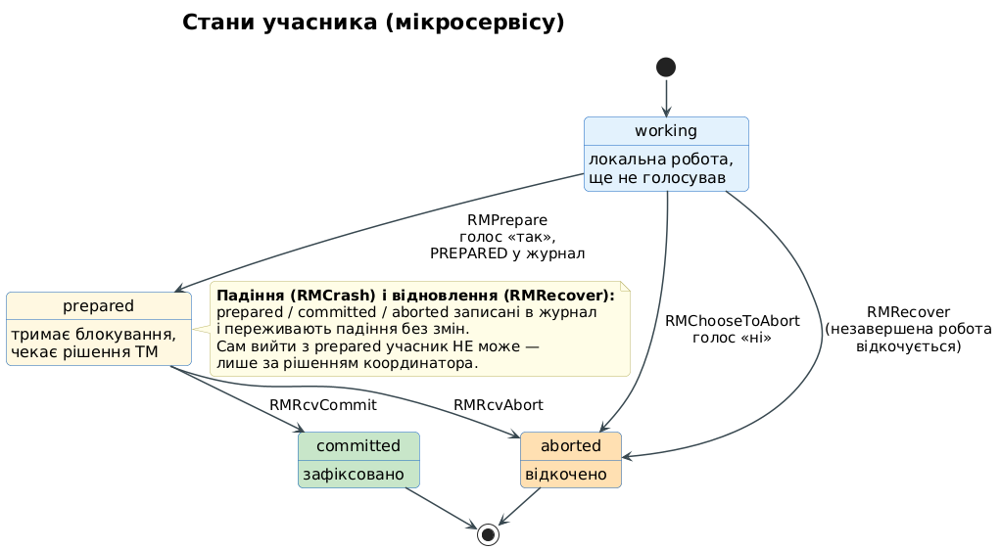
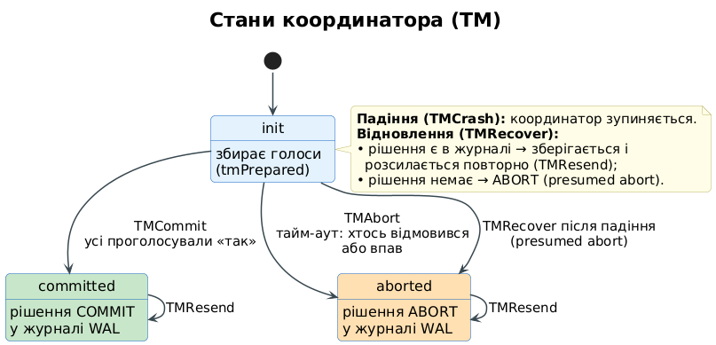
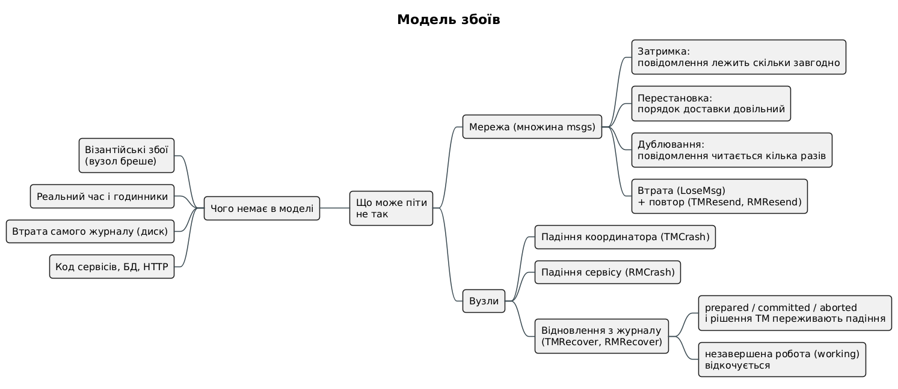

# Як влаштована модель

Модель лежить у двох файлах:

- [`spec/TwoPhase.tla`](../spec/TwoPhase.tla) — учасники, дії, safety-властивості та індуктивний
  інваріант. Цей модуль перевіряють і TLC, і Apalache, і TLAPS.
- [`spec/MCTwoPhase.tla`](../spec/MCTwoPhase.tla) — справедливість (fairness), специфікації
  для різних конфігурацій і liveness-властивості. Його перевіряє лише TLC: Apalache не
  підтримує `ENABLED` і темпоральні оператори, тому модулі навмисно розділені.

Модель описує **протокол**, а не код. Сервіс тут — це не HTTP-обробник і не таблиця в БД, а
автомат із чотирма станами. Мережа — це не TCP, а множина повідомлень «у дорозі».
Цього достатньо: помилки 2PC живуть саме в логіці протоколу (хто, коли і на підставі чого
приймає рішення), а не в тому, як серіалізується JSON.

## Учасники та стан

| Змінна | Тип | Що означає | Аналог у Python |
|---|---|---|---|
| `rmState` | `RM -> {"working","prepared","committed","aborted"}` | стан кожного сервісу | `dict[str, str]` |
| `tmState` | `{"init","committed","aborted"}` | рішення координатора | `str` |
| `tmPrepared` | `SUBSET RM` | від кого координатор уже прочитав «так» | `set[str]` |
| `msgs` | `SUBSET Messages` | повідомлення в мережі | `set[Message]` |
| `tmUp` | `BOOLEAN` | координатор працює | `bool` |
| `rmUp` | `RM -> BOOLEAN` | сервіс працює | `dict[str, bool]` |

`RM` — константа, множина сервісів. У конфігураціях це `{"payment", "inventory", "order"}`
(2–5 сервісів для різних перевірок). `Mutant` — константа-перемикач: `TRUE` вмикає навмисно
зламану версію координатора.

**Стани сервісу:**

- `working` — виконує свою частину роботи, ще не голосував;
- `prepared` — записав `PREPARED` у журнал, проголосував «так», **тримає блокування** і
  вже не має права вирішити сам;
- `committed` / `aborted` — остаточні стани (`Final`).

**Стани координатора:** `init` (збирає голоси) → `committed` або `aborted`.




## Модель мережі

Повідомлень три види: `Prepared(r)` (голос «так» від сервісу `r`), `Commit` і `Abort`
(рішення координатора, адресоване всім).

`msgs` — це **множина**, а не черга. З цього автоматично випливає асинхронна мережа:

- **затримка** — повідомлення може лежати в `msgs` скільки завгодно кроків, бо ніщо не
  змушує його прочитати;
- **перестановка** — порядку в множині немає, читати можна будь-яке;
- **дублювання** — прочитане повідомлення з множини не видаляється, тому його можна
  «доставити» ще раз;
- **втрата** — окрема дія `LoseMsg` видаляє будь-яке повідомлення; щоб протокол не застряг,
  є повторна відправка `TMResend` і `RMResend`.

## Модель збоїв і журнал (WAL)

Будь-який вузол може впасти (`TMCrash`, `RMCrash(r)`) і відновитися (`TMRecover`,
`RMRecover(r)`). Упалий вузол нічого не робить: усі його дії мають умову `tmUp` / `rmUp[r]`.

Змінні `rmState` і `tmState` при падінні **не змінюються** — це і є модель журналу
(write-ahead log): усе, що процес записав перед відповіддю, переживає перезапуск.

- Сервіс після відновлення: `prepared` / `committed` / `aborted` залишаються як були
  (вони в журналі); `working` → `aborted`, бо незавершена локальна робота відкочується.
- Координатор після відновлення:
  - рішення в журналі є → воно зберігається, і `TMResend` розішле його повторно;
  - рішення немає (`init`) → **presumed abort**: координатор вирішує `ABORT`. Це безпечно,
    бо `COMMIT` ще ніхто не міг отримати.

Чого в моделі немає: візантійських збоїв (вузол не бреше), реального часу, втрати самого
журналу (диск не вмирає).



## Тайм-аут лише з реальної причини

```tla
Timeout == \E r \in RM : rmState[r] = "aborted" \/ ~rmUp[r]
```

Координатор вирішує `ABORT`, лише якщо хтось відмовився або хтось недоступний. Чому не
«будь-коли»? Бо тоді в моделі без збоїв координатор міг би «просто так» скасувати
транзакцію, в якій усі проголосували «так», і властивість L4 (нетривіальність: усі «так» і
без збоїв → commit) було б неможливо сформулювати. Реальний тайм-аут спрацьовує саме тоді,
коли відповіді немає, тобто хтось упав або відмовився. Модель описує саме це.

## Усі дії

| Дія TLA+ | Хто | Умова (коли можлива) | Що змінює | Аналог у мікросервісах |
|---|---|---|---|---|
| `TMRcvPrepared(r)` | TM | працює, `tmState = "init"`, є `Prepared(r)` | `tmPrepared ∪ {r}` | координатор прочитав «так» від `r` |
| `TMCommit` | TM | працює, `init`, **усі** в `tmPrepared` (мутант: хоч один) | `tmState = "committed"`, шле `Commit` | записав COMMIT у WAL і розсилає |
| `TMAbort` | TM | працює, `init`, `Timeout` | `tmState = "aborted"`, шле `Abort` | тайм-аут → ABORT |
| `TMResend` | TM | працює, рішення є, його повідомлення загублене | повертає `Commit`/`Abort` у `msgs` | повторна розсилка рішення |
| `TMCrash` | середовище | `tmUp` | `tmUp = FALSE` | процес координатора впав |
| `TMRecover` | TM | `~tmUp` | `tmUp = TRUE`; `init` → `aborted` + `Abort` | рестарт, читання журналу, presumed abort |
| `RMPrepare(r)` | сервіс | працює, `working` | `prepared`, шле `Prepared(r)` | зарезервував ресурс, PREPARED у журнал, «так» |
| `RMChooseToAbort(r)` | сервіс | працює, `working` | `aborted` | бракує грошей/товару — «ні» |
| `RMResend(r)` | сервіс | працює, `prepared`, `Prepared(r)` загублене | повертає `Prepared(r)` | retry голосу |
| `RMRcvCommit(r)` | сервіс | працює, є `Commit` | `committed` | фіксує, знімає блокування |
| `RMRcvAbort(r)` | сервіс | працює, є `Abort` | `aborted` | відкочує |
| `RMCrash(r)` | середовище | `rmUp[r]` | `rmUp[r] = FALSE` | под сервісу впав |
| `RMRecover(r)` | сервіс | `~rmUp[r]` | `rmUp[r] = TRUE`; `working` → `aborted` | рестарт, читання журналу |
| `LoseMsg` | середовище | є хоч одне повідомлення | одне повідомлення зникає | мережа загубила пакет |
| `Done` | — | усі сервіси в `Final` | нічого (`UNCHANGED vars`) | транзакція завершена |

Навіщо `Done`: коли транзакція закінчилась, жодна дія протоколу вже не можлива. Без `Done`
вбудована перевірка тупиків TLC (`CHECK_DEADLOCK TRUE`) вважала б нормальне завершення
тупиком. `Done` явно каже: «тут можна стояти вічно».

## Три відношення переходів

```tla
ProtocolStep == TMCommit \/ TMAbort \/ TMResend \/ TMRecover \/ ... (дії сервісів)
FailureStep  == TMCrash \/ LoseMsg \/ RMCrash(r)

Next             == ProtocolStep \/ FailureStep \/ Done          \* повна модель
NextNoFailures   == ProtocolStep \/ Done                         \* без збоїв
NextNoTMRecovery == ProtocolStepNoTMRecovery \/ FailureStep \/ Done
```

| Варіант | Навіщо |
|---|---|
| `Next` | основна модель: протокол + усі збої + відновлення. На ній доводимо S1–S5 і L1–L3 |
| `NextNoFailures` | без збоїв. Потрібна для L4: «усі сказали так і нічого не ламалось → commit». Зі збоями це неправда (координатор може впасти і за presumed abort скасувати) |
| `NextNoTMRecovery` | координатор, упавши, **не піднімається**. Показує, що safety від відновлення не залежить, а liveness — залежить: 2PC блокується (результат Скіна 1981) |

## Мутант

```tla
TMCommit == ... /\ IF Mutant THEN tmPrepared # {} ELSE tmPrepared = RM
```

З `Mutant = TRUE` координатор комітить, щойно отримав **хоча б один** голос «так». Це
типова помилка реалізації («дочекаємося першої відповіді і поїхали»). Модель-чекер
зобов'язаний її спіймати; якщо не спіймав би — властивості сформульовані слабко. Див.
[results.md](results.md#mutant).

## Справедливість (fairness)

У `MCTwoPhase.tla` до специфікації додано `WF_vars(...)` для кожної дії протоколу. Без
fairness TLC вважав би допустимою поведінку, де система просто перестає робити кроки, і
жодна liveness-властивість не виконувалась би. Дії збоїв fairness **не мають**: вони
можуть статися, а можуть і ні. Чому саме WF, а не SF, пояснено в
[properties.md](properties.md#чому-wf-а-не-sf).
