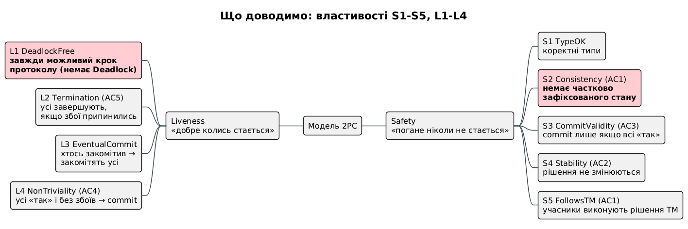

# Властивості S1–S5, L1–L4

Тема роботи вимагає довести, що система **не залишається в частково зафіксованому стані**
і не потрапляє в **Deadlock**. Це дві різні речі, і вони перевіряються різними
властивостями:

- «частково зафіксований стан» (хтось закомітив, а хтось відкотив) — **S2 Consistency**,
  це safety-властивість;
- «Deadlock» (система застрягла і транзакція ніколи не завершиться) — **L1–L3**, це
  liveness-властивості.

Класичні умови атомарного коміту AC1–AC5 взято з книги Bernstein, Hadzilacos, Goodman
«Concurrency Control and Recovery in Database Systems» (1987):

| | Умова |
|---|---|
| AC1 | усі учасники, що прийняли рішення, прийняли **одне й те саме** |
| AC2 | учасник не може змінити прийняте рішення |
| AC3 | рішення COMMIT можливе, лише якщо **всі** проголосували «так» |
| AC4 | якщо збоїв немає і всі проголосували «так», рішення — COMMIT |
| AC5 | якщо збої припинились і нових немає досить довго, усі учасники зрештою приймуть рішення |



## Зведена таблиця

| | Властивість | Вид | AC | Де перевіряється | Результат |
|---|---|---|---|---|---|
| S1 | `TypeOK` | інваріант | — | TLC: Full_2/Full/Full_4/NoFailures/NoTMRecovery_Safety; Apalache у складі `IndInv` | ✔ |
| S2 | `Consistency` | інваріант | AC1 | TLC (усі «правильні» конфігурації), Apalache (3/4/5), TLAPS (будь-яке N) | ✔; мутант — ✘ (очікувано) |
| S3 | `CommitValidity` | інваріант | AC3 | TLC, Apalache, TLAPS | ✔ |
| S4 | `DecisionStable`, `RMStable` | властивість дій | AC2 | TLC | ✔ |
| S5 | `FollowsTM` | інваріант | AC1 | TLC, Apalache, TLAPS | ✔ |
| L1 | `DeadlockFree` | інваріант з `ENABLED` | — | TLC: Full_2/Full/Full_4/NoFailures | ✔; без відновлення TM — ✘ (очікувано) |
| L2 | `Termination` | темпоральна | AC5 | TLC | ✔; без відновлення TM — ✘ (очікувано) |
| L3 | `EventualCommit` | темпоральна | AC1+AC5 | TLC | ✔ |
| L4 | `NonTriviality` | темпоральна | AC4 | TLC: NoFailures | ✔ |

---

## S1. TypeOK — коректність типів

```tla
TypeOK ==
    /\ rmState \in [RM -> {"working", "prepared", "committed", "aborted"}]
    /\ tmState \in {"init", "committed", "aborted"}
    /\ tmPrepared \in SUBSET RM
    /\ msgs \in SUBSET Messages
    /\ tmUp \in BOOLEAN
    /\ rmUp \in [RM -> BOOLEAN]
```

**Людською мовою:** змінні завжди мають очікувані «типи». У TLA+ типів немає, тому це
перевіряють як звичайний інваріант. Аналог — `assert isinstance(...)` після кожного кроку.

`msgs \in SUBSET Messages`, а не `msgs \subseteq Messages`: Apalache з другою формою не
може вивести тип змінної при `--init=IndInv`.

## S2. Consistency — немає частково зафіксованого стану

```tla
Consistency ==
    \A r1, r2 \in RM : ~(rmState[r1] = "aborted" /\ rmState[r2] = "committed")
```

**Людською мовою:** не буває так, щоб один сервіс закомітив, а інший відкотив. Гроші не
списано без замовлення, замовлення не створено без оплати. Це **головна властивість
роботи**.

**Перевірка:** TLC у всіх «правильних» конфігураціях; Apalache — через індуктивний
інваріант для 3, 4, 5 сервісів (будь-яка довжина виконання); TLAPS — для будь-якої
кількості сервісів. На мутанті TLC знаходить порушення, як і має бути.

## S3. CommitValidity — commit лише якщо всі сказали «так»

```tla
CommitValidity ==
    (\E r \in RM : rmState[r] = "committed")
        => (\A r \in RM : rmState[r] \in {"prepared", "committed"})
```

**Людською мовою:** якщо хтось закомітив, то всі сервіси або вже закомітили, або хоча б
проголосували «так» і чекають рішення. Нікого не «закомітили» без його згоди.

## S4. Stability — рішення не змінюються

```tla
DecisionStable == [][tmState # "init" => tmState' = tmState]_vars
RMStable == [][\A r \in RM : rmState[r] \in Final => rmState'[r] = rmState[r]]_vars
```

**Людською мовою:** координатор, вирішивши, не передумає; сервіс, що закомітив або
відкотив, назад не повернеться. Це властивості **кроків** (`[][...]_vars`): вони кажуть,
що стан після кроку (`x'`) пов'язаний зі станом до кроку (`x`) певним чином. Тому їх не
можна перевірити як `INVARIANT`, лише як `PROPERTY`.

## S5. FollowsTM — учасники виконують рішення координатора

```tla
FollowsTM ==
    /\ \A r \in RM : rmState[r] = "committed" => tmState = "committed"
    /\ tmState = "committed" => \A r \in RM : rmState[r] # "aborted"
```

**Людською мовою:** сервіс не комітить, поки координатор не вирішив COMMIT; якщо
координатор вирішив COMMIT, ніхто не відкотився.

---

## L1. DeadlockFree — немає Deadlock

```tla
DeadlockFree == ~AllDone => ENABLED ProtocolStep
```

**Людською мовою:** поки транзакція не завершена, завжди є хоча б один крок
**протоколу**, який можна зробити. Система не може застрягти так, що всі чекають один
одного.

### Чому не вбудований `CHECK_DEADLOCK`

TLC вміє сам шукати тупики: стан, з якого немає жодного переходу. Але в нашій моделі
падіння вузла і втрата повідомлення — теж переходи. Зі стану «усі prepared, координатор
упав» завжди можна зробити `RMCrash` або `LoseMsg`, тож формально тупика немає ніколи, і
вбудована перевірка нічого б не знайшла. Тому `DeadlockFree` перевіряє інше: чи можливий
крок саме **протоколу** (`ENABLED ProtocolStep`), не рахуючи збоїв.

`CHECK_DEADLOCK TRUE` у конфігураціях `Full*` і `NoFailures` теж увімкнено, як додаткову
перевірку; завдяки дії `Done` нормальне завершення тупиком не вважається.

Для моделі без відновлення координатора є варіант `DeadlockFreeNoTMRecovery`, який
дивиться на `ProtocolStepNoTMRecovery`. Там він **порушується**, див.
[results.md](results.md#блокування-без-відновлення-координатора).

## L2. Termination — транзакція завершується

```tla
FailuresForever == []<><<FailureStep>>_vars
Termination == FailuresForever \/ <>AllDone
```

**Людською мовою:** якщо збої колись припиняються, то колись усі сервіси опиняються в
`committed` або `aborted`. `[]<>` означає «знову і знову, нескінченно часто»; `<>` —
«колись».

### Припущення «збої колись припиняються»

Формула читається так: «АБО збої трапляються нескінченно часто, АБО транзакція
завершиться». Тобто завершення гарантується лише для виконань, де збої зрештою
припиняються. Це не підгонка, а рівно умова **AC5**.

Без цього припущення TLC знаходить трасу, де супротивник «роняє» сервіс саме в ту мить,
коли до нього доходить рішення, потім піднімає, і знову роняє, і так без кінця. Завершити
транзакцію в такому світі неможливо **жодним** протоколом: це межа, яку довели Fischer,
Lynch і Paterson (FLP, 1985) для асинхронних систем зі збоями. Це не баг моделі.

Safety-властивості (S1–S5) від припущення **не залежать**: вони перевіряються на всіх
виконаннях, включно з нескінченними збоями.

Чому `FailuresForever \/ <>AllDone`, а не красивий оператор на кшталт
`EventuallyStable(<>P)`: TLC не приймає темпоральну формулу як аргумент оператора
користувача, тому формулу розписано інлайн.

## L3. EventualCommit — хтось закомітив → закомітять усі

```tla
EventualCommit ==
    FailuresForever \/
    ((\E r \in RM : rmState[r] = "committed")
        ~> (\A r \in RM : rmState[r] = "committed"))
```

**Людською мовою:** якщо хоча б один сервіс зафіксував транзакцію, то (за тієї ж умови
про збої) зрештою зафіксують усі. Частковий коміт не лише ніколи не стає остаточним
(S2), а й не «зависає»: решта сервісів доженуть. `P ~> Q` означає «щоразу, коли P, колись
потім Q».

## L4. NonTriviality — протокол не «завжди відміняє»

```tla
NonTriviality ==
    (\A r \in RM : rmState[r] = "prepared")
        ~> (\A r \in RM : rmState[r] = "committed")
```

**Людською мовою:** якщо всі проголосували «так» і збоїв немає, транзакція закомітиться.
Без цієї властивості протокол «завжди ABORT» формально задовольняв би S1–S5 і L1–L3, і
вся перевірка була б тривіальною. Перевіряється в конфігурації `NoFailures`
(специфікація без збоїв), бо зі збоями це неправда: координатор може впасти і за
presumed abort скасувати транзакцію.

---

## Чому WF, а не SF

Слабка справедливість `WF_vars(A)`: «якщо дія A **безперервно** можлива, вона колись
станеться». Сильна `SF_vars(A)`: «якщо A можлива **нескінченно часто** (нехай і з
перервами), вона колись станеться».

У моделі зі збоями здається, що потрібна SF: сервіс то падає, то піднімається, і його
дія то можлива, то ні. Але L2 і L3 перевіряються лише на виконаннях, де збої
припинились. Після останнього збою кожен дозволений крок протоколу залишається
дозволеним, доки його не виконано, а для цього досить WF.

Практичний бік: з SF на всіх ~20 діях liveness-перевірка в TLC ставала на порядки
повільнішою (це помітили на попередньому етапі роботи). З WF конфігурація `Full`
перевіряється за ~4 секунди.

## Індуктивний інваріант IndInv

`IndInv` — допоміжна формула, сильніша за `Consistency`, яку перевіряє Apalache і
доводить TLAPS. Що це таке і як її знайшли, описано в
[results.md](results.md#як-знайшли-індуктивний-інваріант) і
[tla_for_python_devs.md](tla_for_python_devs.md#індуктивний-інваріант).
