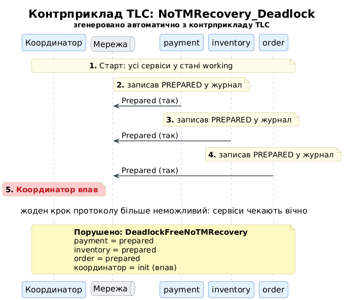
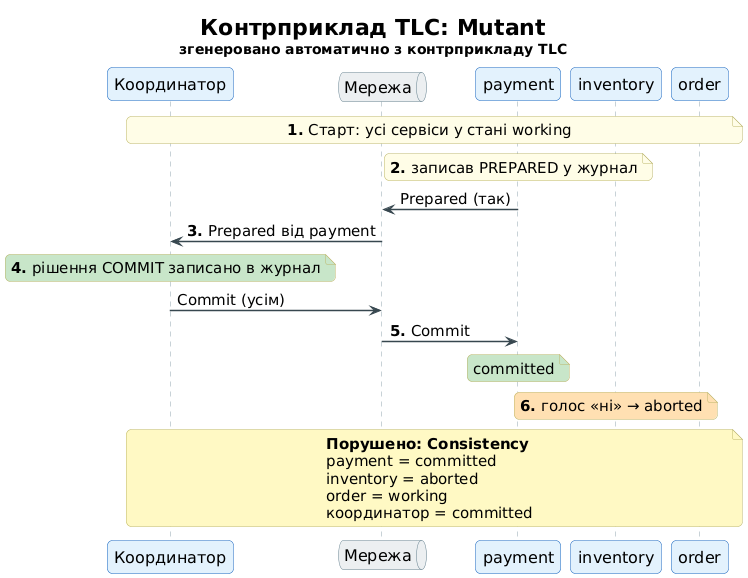
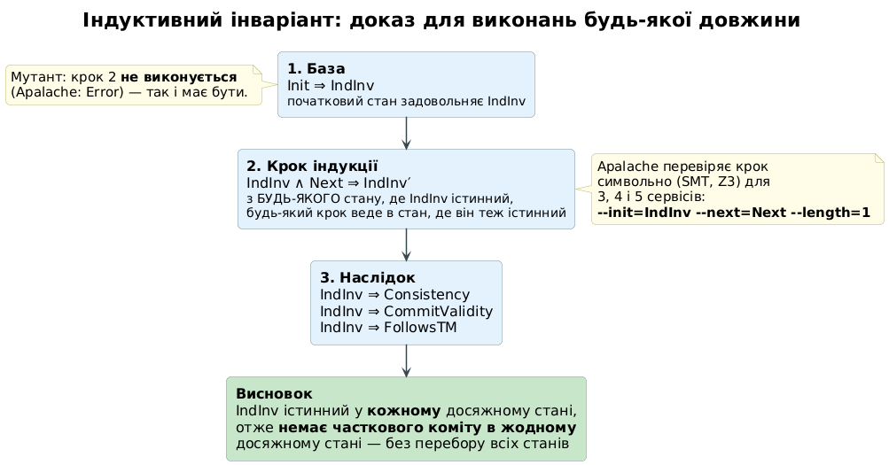

# Результати перевірки

Усі числа нижче взято з реального прогону `python scripts/run_all.py`
([`results/summary.json`](../results/summary.json), сирі логи в
[`results/tlc/`](../results/tlc), [`results/apalache/`](../results/apalache),
[`results/tlaps/`](../results/tlaps)). Згенерована таблиця:
[`results/summary.md`](../results/summary.md).

Інструменти: TLC 2026.11.06 (реліз `v1.8.0`), Apalache 0.50.3, TLAPS 1.6.0-pre, Java 21.
Машина: 4 ядра, 4 ГБ heap для TLC.

**Підсумок: 25 з 25 вердиктів збіглися з очікуваними.**

## TLC

| Конфігурація | Сервісів | Що вмикає | Distinct states | Generated | Глибина | Час | Вердикт |
|---|---|---|---|---|---|---|---|
| Full_2 | 2 | збої + відновлення | 1 840 | 10 525 | 15 | 1,1 с | ✔ No error |
| Full | 3 | збої + відновлення | 28 832 | 218 369 | 20 | 3,7 с | ✔ No error |
| Full_4 | 4 | збої + відновлення | 477 760 | 4 524 241 | 25 | 51,4 с | ✔ No error |
| NoFailures | 3 | без збоїв | 163 | 626 | 11 | 0,8 с | ✔ No error (вкл. L4) |
| NoTMRecovery_Safety | 3 | TM не відновлюється | 28 828 | 203 906 | 21 | 1,4 с | ✔ No error |
| NoTMRecovery_Deadlock | 3 | TM не відновлюється | — | — | — | 0,6 с | ✘ `DeadlockFreeNoTMRecovery` (очікувано) |
| NoTMRecovery_Termination | 3 | TM не відновлюється | — | — | — | 3,6 с | ✘ `Termination` (очікувано) |
| Mutant | 3 | зламаний TM | — | — | — | 0,6 с | ✘ `Consistency` (очікувано) |

Кількість станів у «правильних» конфігураціях збігається з еталоном з попереднього етапу
**точно** (1 840 / 28 832 / 477 760 / 163 / 28 828): модель детермінована, і повний
перебір завжди дає те саме число. Для конфігурацій із порушенням TLC зупиняється на
першій помилці, тому скільки станів він встиг побачити, ні про що не говорить.

Що перевіряється в `Full*`: інваріанти `TypeOK Consistency CommitValidity FollowsTM
DeadlockFree` (S1, S2, S3, S5, L1) і властивості `DecisionStable RMStable Termination
EventualCommit` (S4, L2, L3). У `NoFailures` до них додається `NonTriviality` (L4).

Зверніть увагу на ріст: 2 → 3 → 4 сервіси дають 1,8 тис. → 29 тис. → 478 тис. станів, тобто
приблизно ×16 на кожен новий сервіс. П'ять сервісів TLC уже перевіряв би десятки хвилин;
саме тому для більших N використовуються Apalache і TLAPS.

## Розбір контрприкладів

Порушення в трьох конфігураціях **заплановані**. Вони не означають, що протокол поганий.
Вони показують дві речі:

1. властивості сформульовані **не тривіально**: зламаний протокол вони справді ловлять;
2. відновлення координатора з журналу **необхідне**: без нього 2PC блокується.

Конфігурації з очікуваним порушенням запускаються в один потік (`-workers 1`), тому TLC
щоразу видає той самий найкоротший контрприклад. Саме його видно на діаграмах нижче і в
`run_one.py`.

### Блокування без відновлення координатора

Конфігурація `NoTMRecovery_Deadlock`, діаграма
[`diagrams/generated/NoTMRecovery_Deadlock.puml`](../diagrams/generated/NoTMRecovery_Deadlock.puml)
(рендер: [PNG](../diagrams/rendered/generated_NoTMRecovery_Deadlock.png)), лог
[`results/tlc/NoTMRecovery_Deadlock.txt`](../results/tlc/NoTMRecovery_Deadlock.txt).

| Крок | Дія | Стан після кроку |
|---|---|---|
| 1 | початковий стан | `payment=working inventory=working order=working \| TM=init` |
| 2 | `RMPrepare("payment")` | `payment=prepared …` |
| 3 | `RMPrepare("inventory")` | `payment=prepared inventory=prepared …` |
| 4 | `RMPrepare("order")` | `payment=prepared inventory=prepared order=prepared \| TM=init` |
| 5 | `TMCrash` | `… \| TM=init (впав)` |

Після кроку 5 жодна дія протоколу неможлива: сервіси в `prepared` не мають права
вирішити самі (вони вже пообіцяли закомітити, якщо скаже координатор), а координатор
лежить і не піднімається. Сервіси тримають блокування вічно. Інваріант
`DeadlockFreeNoTMRecovery` (`~AllDone => ENABLED ProtocolStepNoTMRecovery`) порушено.

Це формальне підтвердження результату Dale Skeen (1981): **2PC — блокуючий протокол**.
Жоден учасник у стані `prepared` не може безпечно ні закомітити (раптом хтось сказав
«ні»), ні відкотити (раптом координатор устиг вирішити COMMIT і хтось уже закомітив).



### Незавершення без відновлення координатора

Конфігурація `NoTMRecovery_Termination`, діаграма
[`diagrams/generated/NoTMRecovery_Termination.puml`](../diagrams/generated/NoTMRecovery_Termination.puml).

| Крок | Дія | Стан після кроку |
|---|---|---|
| 1 | початковий стан | усі `working`, `TM=init` |
| 2 | `RMChooseToAbort("payment")` | `payment=aborted` |
| 3 | `RMPrepare("order")` | `order=prepared` |
| 4 | `RMPrepare("inventory")` | `inventory=prepared` |
| 5 | `TMCrash` | `TM=init (впав)` |
| 6 | Stuttering | далі нічого не відбувається (нескінченно) |

Тут уже є причина для ABORT (`payment` відмовився), але координатор упав раніше, ніж
устиг його розіслати. `inventory` і `order` залишаються в `prepared` назавжди. Нових збоїв
у цій поведінці немає (після кроку 5 нічого не відбувається), тобто припущення AC5
виконане, а транзакція все одно не завершується: `Termination` порушено.

«Stuttering» означає, що система стоїть на місці. Fairness цьому не заважає: жодна дія
протоколу не є можливою, а для дій збоїв справедливості немає.

### Мутант

Конфігурація `Mutant`, діаграма
[`diagrams/generated/Mutant.puml`](../diagrams/generated/Mutant.puml),
ручна версія для слайдів — [`counterexample_mutant.puml`](../diagrams/counterexample_mutant.puml).

| Крок | Дія | Стан після кроку |
|---|---|---|
| 1 | початковий стан | усі `working`, `TM=init` |
| 2 | `RMPrepare("payment")` | `payment=prepared` |
| 3 | `TMRcvPrepared("payment")` | координатор знає про одне «так» |
| 4 | `TMCommit` | **помилка мутанта**: COMMIT після одного голосу |
| 5 | `RMRcvCommit("payment")` | `payment=committed` |
| 6 | `RMChooseToAbort("inventory")` | `inventory=aborted` → **частковий коміт** |

Гроші списано (`payment=committed`), товар не зарезервовано (`inventory=aborted`).
`Consistency` (S2) порушено вже на шостому стані: TLC знаходить помилку за 0,6 с.



## Apalache: індуктивний інваріант

| Перевірка | 3 сервіси | 4 сервіси | 5 сервісів |
|---|---|---|---|
| `Init ⇒ IndInv` (база) | ✔ NoError | ✔ NoError | ✔ NoError |
| `IndInv ∧ Next ⇒ IndInv′` (крок) | ✔ NoError | ✔ NoError | ✔ NoError |
| `IndInv ⇒ Consistency` | ✔ NoError | ✔ NoError | ✔ NoError |
| `IndInv ⇒ CommitValidity` | ✔ NoError | ✔ NoError | ✔ NoError |
| `IndInv ⇒ FollowsTM` | ✔ NoError | ✔ NoError | ✔ NoError |

Мутант (`ConstInitMutant`, крок індукції): **Error**, як і очікувалось. Кожна перевірка
займає ~3 с, усі 16 разом — ~48 с.

Що це дає порівняно з TLC: TLC перебирає всі досяжні стани, але лише для 2–4 сервісів.
Apalache перевіряє крок індукції для **будь-якого** стану, що задовольняє `IndInv`, тобто
результат не залежить від довжини виконання і не вимагає перебору. Для N = 3, 4, 5 це
повний доказ того, що частково зафіксованого стану немає в жодному досяжному стані.



### Як знайшли індуктивний інваріант

Перша версія `IndInv` не містила рядка

```tla
\* хто проголосував «так», може відкотитись лише за рішенням координатора
/\ \A r \in RM : (PreparedMsg(r) \in msgs \/ r \in tmPrepared) /\ rmState[r] = "aborted"
                    => tmState = "aborted"
```

На кроці індукції Apalache відповів `Error` і показав такий стан (його легко відтворити:
приберіть цей рядок і запустіть `--init=IndInv --next=Next --length=1`):

```
tmState    = "init"
tmPrepared = {"payment", "inventory", "order"}
rmState    = [payment |-> "aborted", inventory |-> "aborted", order |-> "aborted"]
```

Координатор отримав «так» від усіх, а всі сервіси вже `aborted`. Решта умов `IndInv` у
цьому стані виконуються. Але один крок `TMCommit` (умова `tmPrepared = RM` істинна!) веде
в стан `tmState = "committed"` з відкоченими учасниками, і `IndInv` ламається.

Чи досяжний цей стан? Ні: сервіс, що проголосував «так», переходить у `prepared` і звідти
може потрапити в `aborted` лише через `RMRcvAbort`, тобто коли координатор уже вирішив
ABORT. Але стара `IndInv` цього «не знала». Такий стан називають **контрприкладом до
індукції** (CTI): він не досяжний, але інваріант недостатньо сильний, щоб це виключити.

Виправлення — записати цей факт явно як лему: «хто проголосував "так" і відкотився, той
відкотився за рішенням координатора». З нею крок індукції проходить.

Це типовий цикл роботи з індуктивними інваріантами: інструмент показує CTI, людина
розуміє, яке знання про протокол пропущено, і додає його у вигляді леми.

## TLAPS: доведення для будь-якої кількості сервісів

[`spec/TwoPhaseProofs.tla`](../spec/TwoPhaseProofs.tla):

```tla
THEOREM SafetyTheorem == Spec => [](Consistency /\ CommitValidity /\ FollowsTM)
```

де `Spec == Init /\ [][Next]_vars`, `Mutant = FALSE`, а `RM` — **довільна** множина.
Доведення побудоване за тією ж схемою, що й перевірки Apalache: база, крок (окремо для
кожної з 14 дій, `Done` і кроку «на місці»), наслідок.

Результат: **усі 61 зобов'язання доведено** (`tlapm --cleanfp`, ~4 с), лог
[`results/tlaps/TwoPhaseProofs.txt`](../results/tlaps/TwoPhaseProofs.txt).

Контрольна перевірка, що доведення не тривіальне: якщо прибрати припущення
`Mutant = FALSE`, зобов'язання для `TMCommit` не доводиться (`1/60 obligations failed`).

Що TLAPS **не** покриває: liveness (L1–L4) доведено лише TLC для 2–4 сервісів.

## Що з цього випливає

- **Частково зафіксованого стану немає**: TLC (2–4 сервіси, усі досяжні стани з усіма
  збоями), Apalache (3–5 сервісів, індукція), TLAPS (будь-яке N).
- **Deadlock немає**, якщо координатор відновлюється з журналу: L1–L3 виконуються для 2–4
  сервісів за припущення, що збої колись припиняються.
- **Без відновлення координатора** 2PC блокується, і модель це показує конкретною трасою.
- **Зламана реалізація** ловиться за долю секунди.
